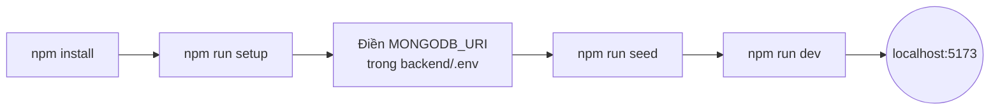

# 01. Bắt đầu nhanh

## Yêu cầu

| Công cụ | Phiên bản     | Ghi chú                                                           |
| ------- | ------------- | ----------------------------------------------------------------- |
| Node.js | **>= 22.12**  | Xem `.nvmrc`. Dùng `nvm use` nếu có nvm                           |
| npm     | >= 10         | Dùng **npm workspaces** (quản lý nhiều package trong 1 repo)      |
| MongoDB | 7+ hoặc Atlas | Local: MongoDB Community Server. Cloud: MongoDB Atlas (free tier) |
| Git     | bất kỳ        |                                                                   |

## Cài đặt lần đầu

```bash
npm install          # cài dependencies cho root + backend + frontend (1 node_modules chung ở root)
npm run setup        # tạo backend/.env & frontend/.env từ .env.example, TỰ SINH secret
```

Sau đó mở `backend/.env`:

1. Điền `MONGODB_URI` (xem [06-environment.md](06-environment.md#database)).
2. Kiểm tra `SUPER_ADMIN_EMAIL` / `SUPER_ADMIN_PASSWORD` (mật khẩu đã được tự sinh).

```bash
npm run seed                 # tạo tài khoản superAdmin
npm run seed -- --samples    # (tuỳ chọn) thêm sản phẩm mẫu
npm run dev                  # chạy backend (8000) + frontend (5173) cùng lúc
```

Mở <http://localhost:5173> và đăng nhập bằng tài khoản superAdmin.



## Các lệnh thường dùng (chạy ở thư mục gốc)

| Lệnh                      | Tác dụng                                                                 |
| ------------------------- | ------------------------------------------------------------------------ |
| `npm run dev`             | Kiểm tra env rồi chạy song song backend + frontend (Ctrl+C dừng cả hai)  |
| `npm run dev:be`          | Chỉ chạy backend (tự restart khi sửa file — `node --watch`)              |
| `npm run dev:fe`          | Chỉ chạy frontend (Vite dev server, HMR — _Hot Module Replacement_)      |
| `npm run build`           | Build frontend ra `frontend/dist`                                        |
| `npm start`               | Chạy backend chế độ production                                           |
| `npm run seed`            | Tạo/nâng quyền superAdmin (thêm `-- --samples`, `-- --reset-password`)   |
| `npm test`                | Chạy toàn bộ test (scripts + backend + frontend)                         |
| `npm run test:be` / `:fe` | Test từng phần                                                           |
| `npm run test:coverage`   | Test kèm báo cáo độ phủ (_coverage_)                                     |
| `npm run lint`            | ESLint toàn repo (`lint:fix` để tự sửa)                                  |
| `npm run format`          | Prettier format toàn repo (`format:check` để chỉ kiểm tra)               |
| `npm run env:check`       | So sánh `.env` với `.env.example` (thiếu / thừa / bắt buộc nhưng trống)  |
| `npm run env:sync`        | Bổ sung biến còn thiếu vào `.env` (giữ giá trị cũ, backup `.env.backup`) |
| `npm run check`           | Chạy tất cả kiểm tra như CI: env + lint + format + test                  |
| `npm run clean`           | Xoá `node_modules`, `dist`, `coverage`                                   |

## Lấy link trong email khi dev

Mặc định `MAIL_DRIVER=console`: email **không gửi thật** mà in ra terminal backend. Khi thử magic link / quên mật khẩu / xác thực email, mở terminal backend và copy link dạng:

```
📧 [MAIL] To: you@example.com
Subject: Liên kết đăng nhập Source Base
...
Đăng nhập: http://localhost:5173/auth/magic-link/verify?token=xxxx
```

## Bật đăng nhập Google / GitHub (tuỳ chọn)

Làm theo hướng dẫn trong comment của `GOOGLE_CLIENT_ID` / `GITHUB_CLIENT_ID` tại `backend/.env.example`. Callback URL cần đăng ký:

- Google: `http://localhost:8000/api/v1/auth/oauth/google/callback`
- GitHub: `http://localhost:8000/api/v1/auth/oauth/github/callback`

Khai báo xong, khởi động lại backend — nút đăng nhập tương ứng tự hiện ở frontend.

## Xử lý sự cố thường gặp

| Triệu chứng                                            | Nguyên nhân / cách xử lý                                                                   |
| ------------------------------------------------------ | ------------------------------------------------------------------------------------------ |
| Backend thoát ngay, báo `Biến môi trường không hợp lệ` | Chạy `npm run env:check`, sửa biến được liệt kê                                            |
| `MongoServerSelectionError`                            | Sai `MONGODB_URI` hoặc chưa whitelist IP trên Atlas (Network Access)                       |
| Frontend báo `Không thể kết nối tới máy chủ`           | Backend chưa chạy hoặc `DEV_API_PROXY_TARGET` sai cổng                                     |
| Đăng nhập xong F5 bị đăng xuất                         | Cookie refresh bị chặn: kiểm tra `COOKIE_SECURE=false` khi chạy http, `COOKIE_SAME_SITE`   |
| Lần đầu `npm test` backend chậm                        | `mongodb-memory-server` tải binary MongoDB (~800MB, chỉ 1 lần, cache lại)                  |
| Port 5173/8000 bị chiếm                                | Đổi `DEV_PORT` / `PORT` và cập nhật `FRONTEND_URL`, `CORS_ORIGINS`, `DEV_API_PROXY_TARGET` |
