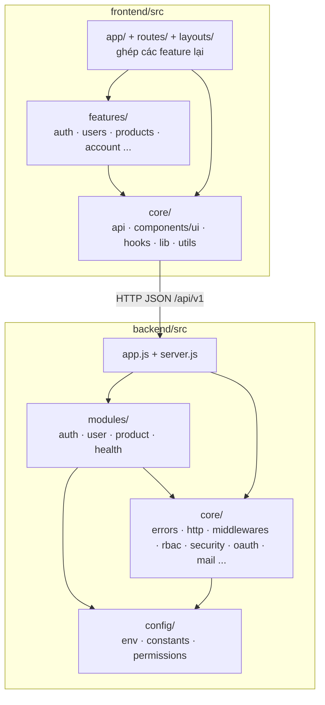
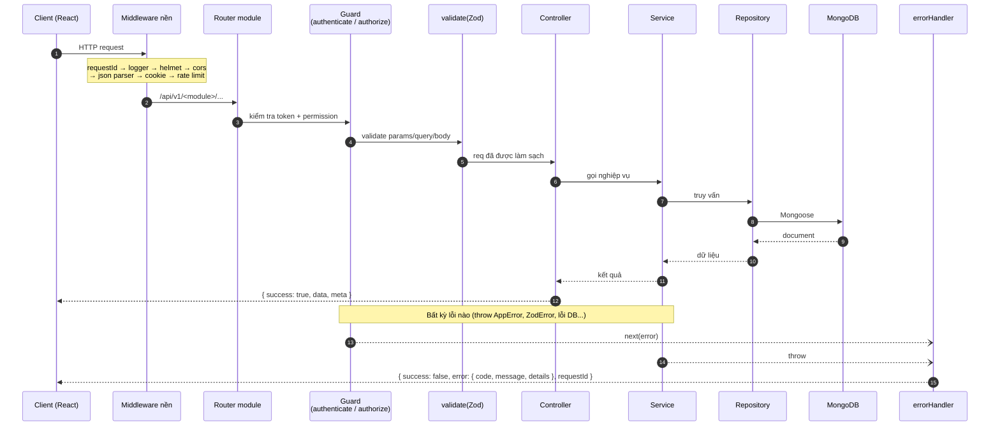
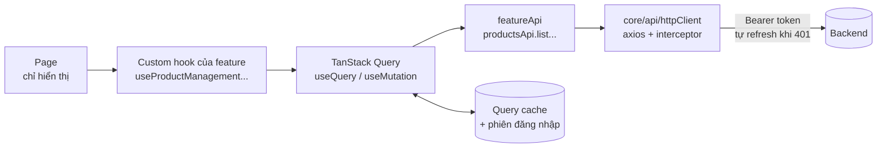

# 02. Kiến trúc tổng quan

## Monorepo với npm workspaces

**Monorepo** (một repo chứa nhiều ứng dụng) giúp chia sẻ tooling (ESLint, Prettier, script) và chạy mọi thứ từ thư mục gốc.

```
.
├── backend/            # REST API - Express 5 (ESM) + MongoDB
├── frontend/           # SPA - React 19 + Vite
├── docs/               # Tài liệu (bạn đang đọc)
├── scripts/            # Script dùng chung: setup, env check/sync, clean
├── package.json        # Root: workspaces + script chung + tooling
├── eslint.config.js    # ESLint flat config cho toàn repo
├── .prettierrc.json    # Prettier cho toàn repo
├── CLAUDE.md           # Hướng dẫn cho Claude Code
└── CHECK_LIST.md       # Theo dõi tiến độ công việc
```

## Nguyên tắc cốt lõi: `core` vs `modules` / `features`

Cả backend lẫn frontend chia làm 2 tầng:

| Tầng                                 | Chứa gì                                                                                                      | Được import từ                             |
| ------------------------------------ | ------------------------------------------------------------------------------------------------------------ | ------------------------------------------ |
| **core**                             | Hạ tầng dùng chung, **không chứa nghiệp vụ**: error, validate, logger, http client, UI kit, hook tiện ích... | Mọi nơi                                    |
| **modules** (BE) / **features** (FE) | Nghiệp vụ theo từng tính năng: auth, user, product...                                                        | Chỉ app/route + module khác qua public API |

Quy tắc phụ thuộc: `core` **không bao giờ** import từ `modules/features`. Nhờ vậy, khi dùng source base cho dự án mới chỉ cần giữ `core` + module nền tảng (auth, user) và thay module nghiệp vụ.



## Luồng một request (backend)



**Trách nhiệm từng lớp (backend):**

| Lớp        | Làm gì                                                 | Không làm gì                         |
| ---------- | ------------------------------------------------------ | ------------------------------------ |
| Route      | Khai báo URL + ghép middleware (guard, validate)       | Chứa logic                           |
| Controller | Đọc input đã validate, gọi service, trả response chuẩn | Truy vấn DB, kiểm tra quyền chi tiết |
| Service    | Nghiệp vụ, quy tắc, ném `AppError`                     | Biết về `req`/`res`                  |
| Repository | Truy vấn DB (kế thừa `BaseRepository`)                 | Nghiệp vụ                            |
| Model      | Schema Mongoose, index, plugin                         |                                      |

## Luồng dữ liệu frontend



- **Page** mỏng: nhận state/hành động từ custom hook.
- **Custom hook** (vd `useProductManagement`) gom: tham số URL, query, mutation, modal, toast.
- **API layer** chỉ lo HTTP, không state.
- **httpClient** tự gắn token, tự refresh, chuẩn hoá lỗi thành `ApiError`.

## Định dạng response chuẩn

```jsonc
// Thành công
{ "success": true, "message": "Tạo sản phẩm thành công", "data": { ... }, "meta": { "page": 1, ... } }

// Lỗi
{
  "success": false,
  "error": {
    "code": "VALIDATION_ERROR",          // máy đọc - frontend xử lý theo code
    "message": "Dữ liệu không hợp lệ",   // người đọc
    "details": [{ "location": "body", "path": "email", "message": "Email không hợp lệ" }]
  },
  "requestId": "a1b2c3..."               // gửi kèm khi báo lỗi để tra log
}
```

## Công nghệ chính

| Nhóm      | Backend                                     | Frontend                                    |
| --------- | ------------------------------------------- | ------------------------------------------- |
| Runtime   | Node.js 22+, **ESM** (`import/export`)      | Vite 8, React 19                            |
| Framework | Express 5                                   | React Router 8 (`createBrowserRouter`)      |
| Dữ liệu   | MongoDB + Mongoose 9                        | TanStack Query 5 + Axios                    |
| Validate  | Zod 4                                       | Zod 4 + react-hook-form                     |
| Bảo mật   | helmet, cors, rate-limit, JWT, scrypt, PKCE | Token trong bộ nhớ, refresh cookie httpOnly |
| UI        | —                                           | Tailwind CSS 4                              |
| Log       | pino (+ pino-pretty khi dev)                | —                                           |
| Test      | Vitest, Supertest, mongodb-memory-server    | Vitest, Testing Library, MSW, jsdom         |
