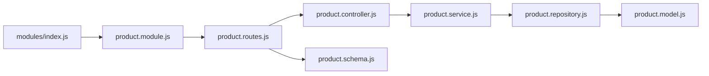
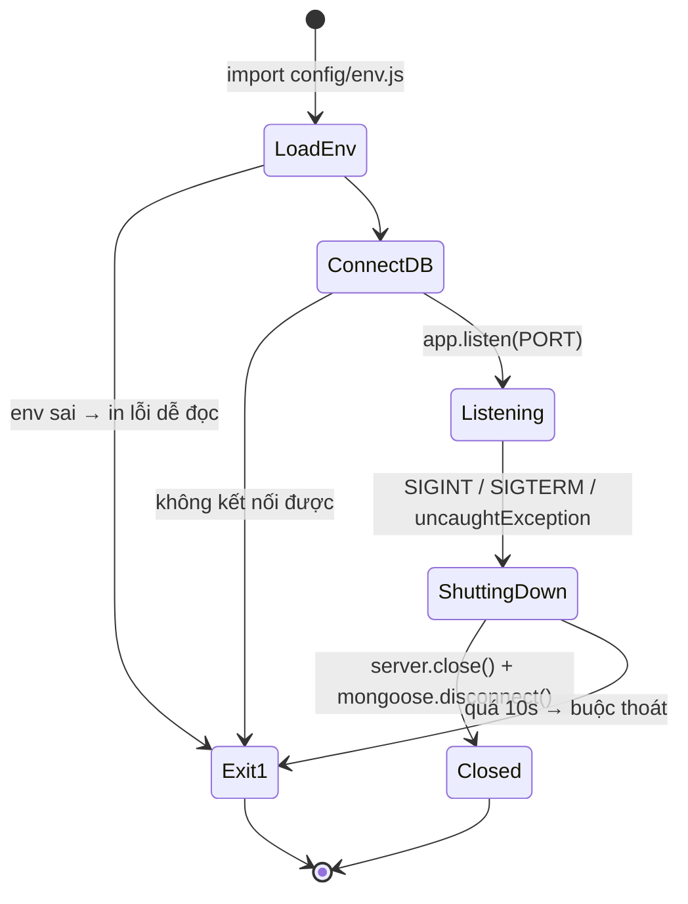

# 03. Backend

## Cấu trúc thư mục

```
backend/
├── src/
│   ├── server.js                 # Entry: kết nối DB → listen → graceful shutdown
│   ├── app.js                    # createApp(): Express app (không listen) → test dùng trực tiếp
│   ├── config/
│   │   ├── env.js                # Nạp + validate env bằng Zod (fail-fast)
│   │   ├── constants.js          # API_PREFIX, tên cookie, phân trang, path frontend
│   │   └── permissions.js        # Ma trận RBAC của dự án (permission ↔ role)
│   ├── core/                     # Hạ tầng dùng chung - KHÔNG chứa nghiệp vụ
│   │   ├── base/BaseRepository.js
│   │   ├── database/             # connect/disconnect, plugin toJSON
│   │   ├── errors/               # AppError, ErrorCodes
│   │   ├── http/                 # asyncHandler, response helpers, defineModule
│   │   ├── logger/               # pino logger
│   │   ├── mail/                 # sendMail (driver console | memory), layout email
│   │   ├── middlewares/          # requestId, httpLogger, validate, errorHandler, notFound, rateLimiter
│   │   ├── oauth/                # OAuth 2.0 client (Google, GitHub) + PKCE
│   │   ├── rbac/                 # roles, policy, authorize()
│   │   ├── security/             # password (scrypt), jwt, token ngẫu nhiên, cookie options
│   │   ├── utils/                # duration, pagination, sort, object, string, url
│   │   └── validation/common.js  # Zod schema dùng chung (email, password, objectId, phân trang)
│   ├── modules/
│   │   ├── index.js              # Danh sách module được mount vào /api/v1
│   │   ├── health/
│   │   ├── auth/                 # Xác thực 3 phương thức + session
│   │   ├── user/                 # Quản trị người dùng + hồ sơ cá nhân
│   │   └── product/              # Module MẪU - copy khi tạo module mới
│   └── scripts/                  # seed.js (CLI) + seeders.js (logic, có test)
├── tests/
│   ├── setup/                    # globalSetup (MongoMemoryServer), database.js
│   ├── helpers.js                # createUser, loginAs, getCookie, getTokenFromLastMail...
│   ├── unit/                     # Test hàm thuần / middleware độc lập
│   └── integration/              # Test API end-to-end qua Supertest
└── vitest.config.js
```

**Subpath imports** (_đường dẫn import rút gọn khai báo ở `package.json > imports`_): `#config/*`, `#core/*`, `#modules/*`, `#tests/*` — tránh `../../../`.

## Các thành phần core

### 1. Xử lý lỗi — `AppError` + `errorHandler`

```js
import { AppError } from '#core/errors/AppError.js';

throw AppError.notFound('Sản phẩm'); // 404 NOT_FOUND "Sản phẩm không tồn tại"
throw AppError.forbidden(); // 403 FORBIDDEN
throw AppError.conflict('Email đã được sử dụng', { fields: ['email'] });
throw new AppError('Hết hàng', { statusCode: 409, code: 'OUT_OF_STOCK' });
```

`errorHandler` (middleware cuối cùng) chuẩn hoá **mọi** loại lỗi:

| Lỗi gốc                      | HTTP | code                                                            |
| ---------------------------- | ---- | --------------------------------------------------------------- |
| `AppError`                   | tuỳ  | tuỳ                                                             |
| `ZodError`                   | 422  | `VALIDATION_ERROR`                                              |
| Mongoose `CastError`         | 400  | `BAD_REQUEST`                                                   |
| Mongoose `ValidationError`   | 422  | `VALIDATION_ERROR`                                              |
| Mongo duplicate key `E11000` | 409  | `CONFLICT`                                                      |
| JWT hết hạn / sai            | 401  | `TOKEN_EXPIRED` / `INVALID_TOKEN`                               |
| JSON body sai cú pháp        | 400  | `INVALID_JSON`                                                  |
| Body quá lớn                 | 413  | `PAYLOAD_TOO_LARGE`                                             |
| Còn lại                      | 500  | `INTERNAL_ERROR` (ẩn chi tiết ở production, có `debug` khi dev) |

### 2. Async handler

Express 5 đã tự bắt promise bị reject, nhưng dự án vẫn dùng `asyncHandler` / `asyncHandlers` để thống nhất cách viết và đảm bảo cả lỗi sync lẫn async đều về `errorHandler`:

```js
export const productController = asyncHandlers({
  async list(req, res) {
    sendPaginated(res, await productService.list(req.query));
  },
});
```

### 3. Validation với Zod — `validate()`

```js
router.patch('/:id', validate({ params: idParamsSchema, body: updateSchema }), controller.update);
```

- Validate `params`, `query`, `body`; **gom tất cả lỗi** rồi trả 422 một lần.
- Dữ liệu sau parse (đã `trim`, `coerce`, `default`) **ghi đè** lại `req.body/query/params` → controller luôn nhận dữ liệu sạch.
- Express 5: `req.query` là getter chỉ đọc → middleware dùng `Object.defineProperty` để ghi đè an toàn.
- Schema dùng chung: `emailSchema`, `passwordSchema`, `objectIdSchema`, `paginationQuerySchema({ sortFields })` trong `core/validation/common.js`.
- Dùng `.strict()` cho body update để chặn **mass assignment** (_client gửi thêm field nhạy cảm như `role`_).

### 4. Response helpers

`sendSuccess`, `sendCreated`, `sendPaginated`, `sendNoContent` — luôn trả đúng định dạng `{ success, message, data, meta }`.

### 5. BaseRepository

```js
class ProductRepository extends BaseRepository {
  constructor() {
    super(Product);
  }
  findPublished() {
    return this.model.find({ isPublished: true });
  } // query riêng
}
```

Có sẵn: `create`, `findById`, `findOne`, `find`, `exists`, `count`, `updateById` (chạy validator), `deleteById`, `paginate(filter, { page, limit, sort, select, populate })` → `{ items, meta }`.

### 6. Plugin `toJSON`

Gắn vào schema: đổi `_id` → `id`, bỏ `__v`, **tự loại field có `private: true`** (vd `passwordHash`, `tokenHash`) khỏi mọi response.

### 7. Logger (pino)

- `logger` / `createLogger('module')`; không dùng `console` trong `src/` (ESLint chặn).
- Tự **redact** (_che_) `authorization`, `cookie`, `password`, `token`...
- Mỗi request có `requestId` (header `X-Request-Id`) để truy vết.

### 8. Bảo mật mặc định

`helmet` (security headers), `cors` theo whitelist `CORS_ORIGINS` + `credentials`, `express-rate-limit` (chung + riêng cho auth), giới hạn body 1MB, `trust proxy` theo env, cookie `httpOnly`/`secure`/`sameSite`.

## Module

Mỗi module là một thư mục tự đóng gói:

```
modules/product/
├── product.model.js        # Mongoose schema
├── product.repository.js   # extends BaseRepository
├── product.schema.js       # Zod schema cho request
├── product.service.js      # Nghiệp vụ
├── product.controller.js   # asyncHandlers({...})
├── product.routes.js       # Router + guard + validate
└── product.module.js       # defineModule({ name, basePath, router })
```



### Thêm module mới (ví dụ `order`)

1. Copy `modules/product` → `modules/order`, đổi tên file/biến.
2. Khai báo permission trong `config/permissions.js` (`ORDER_READ: 'order:read'`...) và gán cho role.
3. Thêm `orderModule` vào mảng trong `modules/index.js`.
4. Viết test `tests/integration/orders.test.js` (copy từ `products.test.js`).
5. Cập nhật `docs/09-api-reference.md` + `CHECK_LIST.md`.

## Server lifecycle



## Seed dữ liệu

```bash
npm run seed                      # tạo superAdmin từ SUPER_ADMIN_* (idempotent - chạy lại không trùng)
npm run seed -- --samples         # + 5 sản phẩm mẫu nếu collection trống
npm run seed -- --reset-password  # đặt lại mật khẩu superAdmin theo env
```

> superAdmin **chỉ** tạo được qua seed/DB, không tạo được qua API (xem [04-auth-rbac.md](04-auth-rbac.md)).
