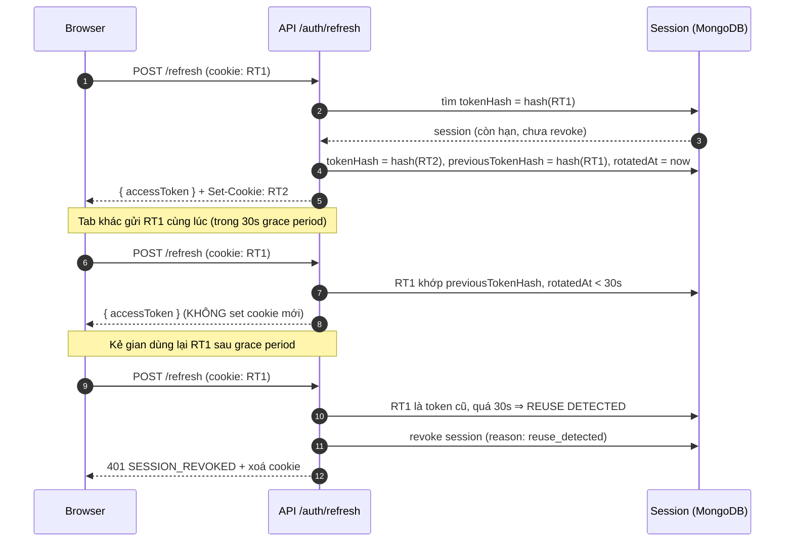
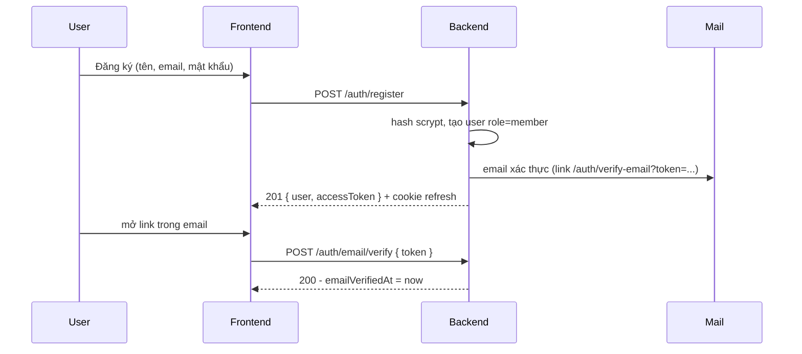
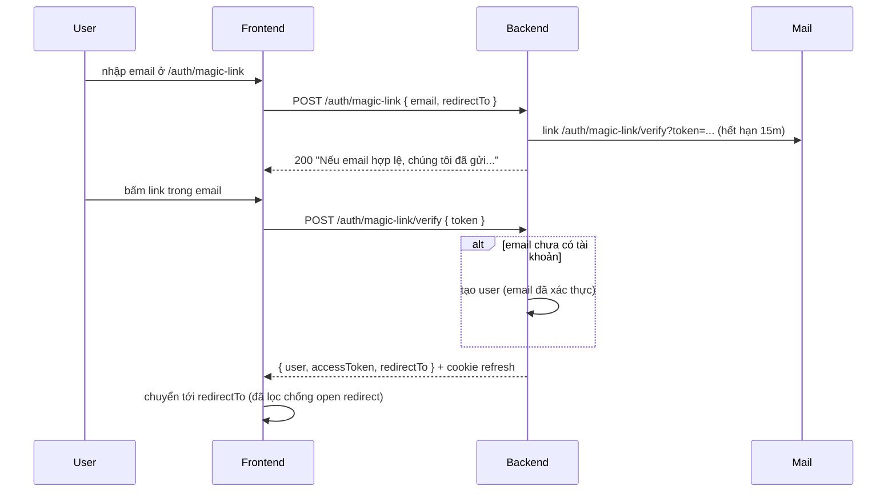
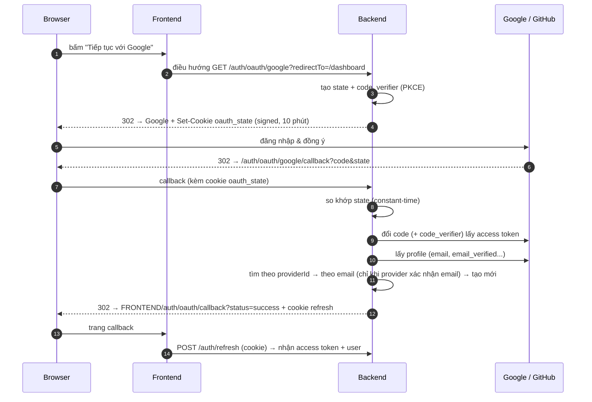
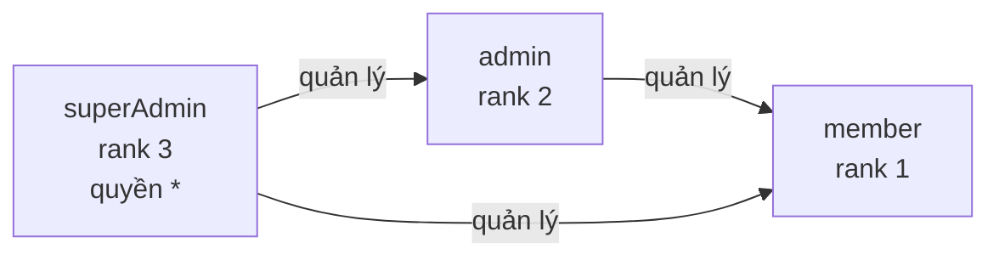
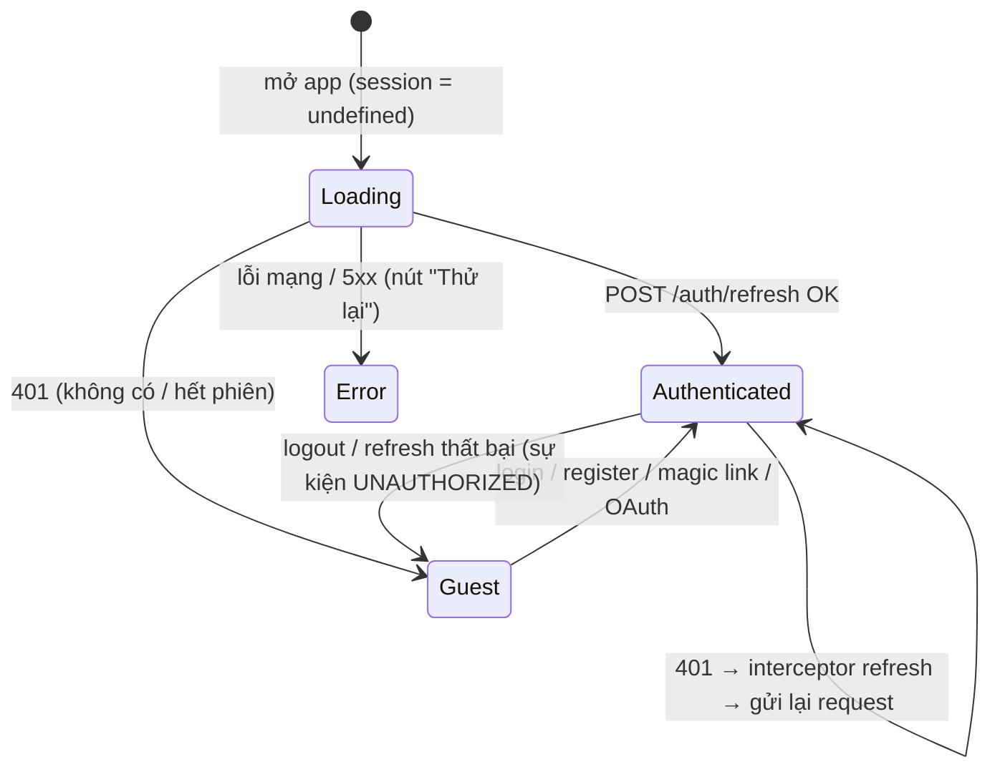

# 04. Xác thực (Authentication) & Phân quyền (Authorization - RBAC)

- **Authentication** (_xác thực_): bạn là ai? → 3 phương thức: email/mật khẩu, OAuth, magic link.
- **Authorization** (_phân quyền_): bạn được làm gì? → **RBAC** (_Role-Based Access Control — phân quyền theo vai trò_) với 3 role.

## Mô hình token

| Token             | Dạng                             | Lưu ở đâu (client)                                             | Thời hạn (mặc định) | Mục đích                                         |
| ----------------- | -------------------------------- | -------------------------------------------------------------- | ------------------- | ------------------------------------------------ |
| **Access token**  | JWT (HS256) `{ sub, role, sid }` | **Bộ nhớ JS** (`tokenStore`), không localStorage               | 15 phút             | Gửi kèm mọi request: `Authorization: Bearer ...` |
| **Refresh token** | Chuỗi ngẫu nhiên 48 byte         | **Cookie `httpOnly`** (JS không đọc được), path `/api/v1/auth` | 7 ngày (trượt)      | Lấy access token mới                             |

Vì sao?

- Access token trong bộ nhớ → script độc hại (**XSS** — _chèn mã JS_) khó lấy cắp lâu dài; hết hạn nhanh.
- Refresh token `httpOnly` → JS không đọc được; DB chỉ lưu **hash SHA-256** → lộ DB không lộ token.
- Reload trang: access token mất → app tự gọi `POST /auth/refresh` (cookie tự gửi) để khôi phục phiên.

## Phiên đăng nhập & Refresh Token Rotation

Mỗi lần đăng nhập (bất kể phương thức) tạo 1 **Session** (_một thiết bị_) trong MongoDB. Mỗi lần refresh, token được **xoay vòng** (_rotation_): token cũ hết hiệu lực, token mới được cấp.



- **Grace period 30s**: nhiều tab refresh đồng thời không bị đăng xuất nhầm.
- **Reuse detection** (_phát hiện dùng lại_): token cũ xuất hiện sau grace period ⇒ nghi bị đánh cắp ⇒ thu hồi cả session.
- **Sliding expiration**: mỗi lần refresh gia hạn thêm `REFRESH_TOKEN_EXPIRES_IN`.
- MongoDB **TTL index** tự xoá session hết hạn.
- Người dùng xem & thu hồi từng thiết bị: `GET/DELETE /auth/sessions`, hoặc `POST /auth/logout-all`.
- Đổi mật khẩu → thu hồi các thiết bị khác; đặt lại mật khẩu → thu hồi **tất cả**.

## Phương thức 1: Email + mật khẩu



- Mật khẩu: 8–128 ký tự, có chữ + số. Hash bằng **scrypt** (_thuật toán băm chậm, chống brute-force_; built-in Node, không cần native addon).
- Đăng nhập sai (email không tồn tại hoặc sai mật khẩu) trả **cùng một lỗi** `INVALID_CREDENTIALS` và **cùng thời gian xử lý** (verify với hash giả) → chống dò email.
- Quên mật khẩu: `POST /auth/password/forgot` luôn trả cùng message dù email có tồn tại hay không.
- Token email (verify / reset / magic link) là **one-time token**: chỉ lưu hash, dùng 1 lần (atomic `findOneAndUpdate`), có hạn, yêu cầu link mới ⇒ link cũ vô hiệu.

## Phương thức 2: Magic link



- Tài khoản chỉ được tạo **khi mở link** (tránh tạo rác khi gõ nhầm email).
- Trang verify dùng `useRunOnce` → token chỉ bị gửi 1 lần kể cả dưới React StrictMode.

## Phương thức 3: OAuth 2.0 (Google, GitHub)

**OAuth 2.0 Authorization Code Flow** (_luồng uỷ quyền bằng mã_) + **PKCE** (_Proof Key for Code Exchange — chống đánh cắp authorization code_) + **state** (_chống CSRF_).



- **Không có token trong URL** — frontend lấy phiên qua refresh cookie.
- Liên kết tài khoản sẵn có **chỉ khi provider xác nhận email** (chống chiếm tài khoản bằng email giả).
- Lỗi → redirect `?status=error&code=...` (`OAUTH_ACCESS_DENIED`, `OAUTH_STATE_MISMATCH`, `OAUTH_EMAIL_REQUIRED`, `CONFLICT`, `ACCOUNT_DISABLED`), trang callback hiển thị message tiếng Việt.
- Provider chỉ bật khi đủ `CLIENT_ID` + `CLIENT_SECRET`; `GET /auth/providers` trả danh sách → FE tự ẩn/hiện nút.
- Thêm provider: thêm entry trong `backend/src/core/oauth/providers.js` + enum env + label FE.

## RBAC — 3 role



### Ma trận quyền (`backend/src/config/permissions.js`)

| Permission         | member | admin | superAdmin |
| ------------------ | :----: | :---: | :--------: |
| `profile:read`     |   ✅   |  ✅   |     ✅     |
| `profile:update`   |   ✅   |  ✅   |     ✅     |
| `product:read`     |   ✅   |  ✅   |     ✅     |
| `product:create`   |        |  ✅   |     ✅     |
| `product:update`   |        |  ✅   |     ✅     |
| `product:delete`   |        |  ✅   |     ✅     |
| `user:read`        |        |  ✅   |     ✅     |
| `user:update`      |        |  ✅*  |    ✅*     |
| `user:delete`      |        |  ✅*  |    ✅*     |
| `user:role:update` |        |       |    ✅*     |

\* Kèm **quy tắc cấp bậc** (`core/rbac/policy.js`):

- `canManageUser(actor, target)`: chỉ tác động lên người có **rank thấp hơn** và **không phải chính mình** (tránh tự khoá / tự hạ quyền).
- `canAssignRole(actorRole, role)`: chỉ gán role **thấp hơn** role của mình ⇒ superAdmin gán được `admin`/`member`, **không ai tạo được superAdmin qua API** (chỉ qua `npm run seed`).

### Sử dụng ở backend

```js
import { PERMISSIONS, authorize } from '#core/rbac/index.js';
import { authenticate } from '#modules/auth/auth.middleware.js';

router.post(
  '/',
  authenticate,
  authorize(PERMISSIONS.PRODUCT_CREATE),
  validate(schema),
  controller.create,
);
```

- `authenticate`: đọc Bearer token → **luôn đọc user từ DB** (role mới / bị khoá có hiệu lực ngay) → `req.user`, `req.sessionId`.
- `optionalAuthenticate`: có token thì gắn user, không có thì bỏ qua.
- `requireVerifiedEmail`: chặn user chưa xác thực email (dùng cho tính năng nhạy cảm).
- `authorize(...permissions)`: cần **tất cả** permission; `requireRoles(...roles)` khi thật sự gắn với role.

### Sử dụng ở frontend

Backend trả `user.permissions` trong mọi response đăng nhập/`/auth/me` ⇒ frontend **không hard-code ma trận quyền**.

```jsx
const { can, hasRole } = useAuth();
can('product:create');                 // true/false

<Can permission={PERMISSIONS.PRODUCT_DELETE}><Button>Xoá</Button></Can>

// Route
{ element: <RequirePermission permission={PERMISSIONS.USER_READ} />, children: [...] }
```

> Kiểm tra ở frontend chỉ để **ẩn/hiện UI**. Backend mới là lớp bảo vệ thật sự.

## Frontend: vòng đời phiên



- Phiên lưu trong TanStack Query cache, key `['auth','session']` (`undefined` = đang tải, `null` = khách, object = user).
- `httpClient` gặp 401 ⇒ gọi refresh **một lần duy nhất** (single-flight) cho mọi request đang chờ, rồi gửi lại.
- Refresh thất bại ⇒ phát `auth:unauthorized` ⇒ `AuthSync` xoá phiên + cache ⇒ guard chuyển về `/auth/login?redirectTo=...`.

## Checklist bảo mật đã áp dụng

- [x] Hash mật khẩu scrypt + so sánh constant-time; hash giả chống timing attack
- [x] JWT chỉ định thuật toán khi verify (chặn `alg: none`), kiểm tra `issuer` + `typ`
- [x] Refresh token rotation + reuse detection + lưu hash
- [x] Cookie `httpOnly`, `secure` (bắt buộc ở production), `sameSite`, path hẹp
- [x] OAuth: state (CSRF) trong signed cookie, PKCE, chỉ link khi email đã xác thực
- [x] One-time token cho email, atomic consume, TTL index
- [x] Chống open redirect (`redirectTo` chỉ nhận path nội bộ, cả FE lẫn BE)
- [x] Chống dò email (thông báo chung cho forgot/magic link)
- [x] Rate limit riêng cho endpoint auth
- [x] Zod `.strict()` chống mass assignment; escape regex khi tìm kiếm
- [x] superAdmin không thể tạo qua API
