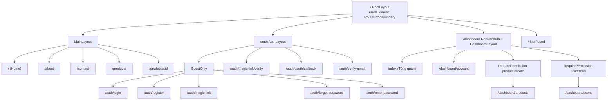
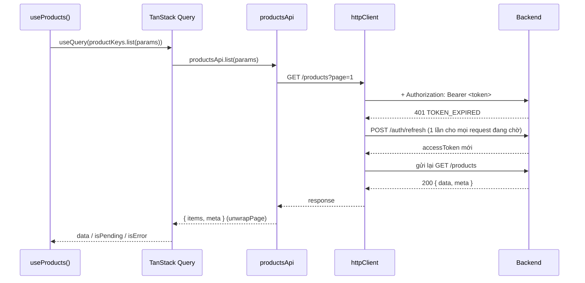
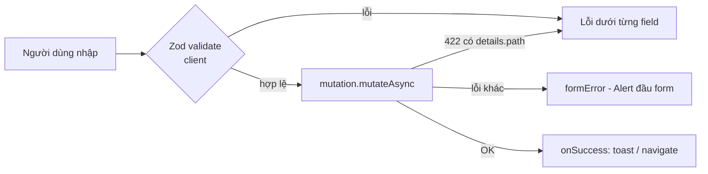

# 05. Frontend

## Cấu trúc thư mục

```
frontend/src/
├── main.jsx                 # Mount React (StrictMode)
├── app/
│   ├── App.jsx              # <AppProviders><RouterProvider router={router} /></AppProviders>
│   └── AppProviders.jsx     # QueryClientProvider, AuthSync, Toaster, Devtools
├── routes/
│   ├── index.jsx            # createBrowserRouter(routes)
│   ├── routes.jsx           # Cây route (lazy load từng trang) - test được bằng createMemoryRouter
│   └── paths.js             # PATHS - mọi đường dẫn ở 1 chỗ + safeRedirectPath()
├── layouts/                 # RootLayout, MainLayout (public), AuthLayout, DashboardLayout
├── core/                    # Dùng chung, KHÔNG biết về feature cụ thể
│   ├── api/                 # httpClient (axios + refresh), tokenStore, ApiError
│   ├── components/ui/       # Button, TextField, Modal, Card, Alert, Pagination... (Tailwind)
│   ├── components/feedback/ # PageLoader, QueryState, Toaster, RouteErrorBoundary
│   ├── config/env.js        # Validate import.meta.env bằng Zod
│   ├── constants/rbac.js    # ROLES, PERMISSIONS, hasPermission, canManageUser
│   ├── hooks/               # useZodForm, useFormMutation, useListParams, useDebounce, useDisclosure, useRunOnce
│   ├── lib/                 # queryClient, cn (clsx + tailwind-merge), toast store
│   ├── utils/               # format (tiền, ngày), form (map lỗi server vào field)
│   └── validation/common.js # emailSchema, passwordSchema... (khớp backend)
├── features/                # Mỗi feature tự đóng gói
│   ├── auth/                # api, hooks, guards, components, pages, schemas, lib/session, index.js
│   ├── account/             # Hồ sơ, đổi mật khẩu, thiết bị đăng nhập
│   ├── products/            # Module mẫu: danh sách, chi tiết, quản trị CRUD
│   ├── users/               # Quản trị người dùng theo RBAC
│   ├── dashboard/  home/  errors/
├── styles/index.css         # Tailwind v4 + design token (@theme)
└── test/                    # setup, MSW handlers, render helpers, fixtures
```

Alias `@` → `src/` (khai báo ở `vite.config.js`): `import { Button } from '@/core/components/ui'`.

### Cấu trúc một feature

```
features/products/
├── api/productsApi.js          # Chỉ gọi HTTP: list, getById, create, update, remove
├── productKeys.js              # Query key factory
├── hooks/
│   ├── useProducts.js          # useProducts, useProduct, useCreateProduct... (dùng lại mọi nơi)
│   └── useProductManagement.js # Hook điều phối cho trang quản trị
├── schemas/productSchema.js    # Zod schema của form
├── components/                 # ProductForm, ProductTable, ProductCard, ProductFilters
├── pages/                      # ProductListPage, ProductDetailPage, ProductManagementPage (default export)
└── index.js                    # Public API - feature khác chỉ import từ đây
```

## Routing — `createBrowserRouter`

Cây route nằm ở `routes/routes.jsx`, tách khỏi `createBrowserRouter` (`routes/index.jsx`) để test dùng lại bằng `createMemoryRouter`.



- Mỗi trang **lazy-load** (`lazy: page(() => import(...))`) → mỗi trang là 1 chunk JS riêng.
- Guard là **layout route** (render `<Outlet/>`): `RequireAuth`, `RequirePermission`, `GuestOnly`.
- Không hard-code URL: luôn dùng `PATHS.xxx`. `redirectTo` luôn qua `safeRedirectPath()` (chống open redirect).

## Gọi API — Axios + TanStack Query



**Quy ước:**

| Việc                           | Cách làm                                                                            |
| ------------------------------ | ----------------------------------------------------------------------------------- |
| Query key                      | Factory theo feature: `productKeys.list(params)`, `productKeys.detail(id)`          |
| Danh sách phân trang           | `placeholderData: keepPreviousData` → không nháy loading khi chuyển trang           |
| Sau mutation                   | `invalidateQueries(productKeys.lists())`, `setQueryData(detail)` khi có dữ liệu mới |
| Lỗi                            | Luôn là `ApiError { status, code, message, details, requestId }`                    |
| Retry                          | Không retry lỗi 4xx; tối đa 2 lần với lỗi mạng/5xx                                  |
| Request không cần auto-refresh | Truyền `NO_AUTH_REFRESH` (login, register, magic link verify...)                    |
| Loading/error UI               | `<QueryState query={q}>{(data) => ...}</QueryState>`                                |

## Form — react-hook-form + Zod

Pattern chung cho **mọi form gọi API**: `useFormMutation`.

```jsx
export function LoginForm({ onSuccess }) {
  const login = useLogin(); // TanStack mutation
  const { form, submit, formError, isSubmitting } = useFormMutation({
    schema: loginSchema, // Zod (validate client)
    mutation: login, // hoặc mutationFn: async (values) => ...
    defaultValues: { email: '', password: '' },
    onSuccess,
  });
  const {
    register,
    formState: { errors },
  } = form;

  return (
    <form onSubmit={submit} noValidate>
      {formError && <Alert variant="error">{formError}</Alert>}
      <TextField label="Email" error={errors.email?.message} {...register('email')} />
      <Button type="submit" loading={isSubmitting}>
        Đăng nhập
      </Button>
    </form>
  );
}
```



- `TextField` / `TextareaField` / `SelectField` nhận thẳng `{...register('x')}` (React 19: `ref` là prop thường).
- Lỗi field có `aria-invalid` + `aria-describedby` → thân thiện screen reader.
- Schema FE dùng chung quy tắc với BE (`core/validation/common.js` ↔ `backend/src/core/validation/common.js`).

## Custom hook cho feature lớn

Mỗi feature lớn có **2 tầng hook**:

1. **Hook dữ liệu** (tái sử dụng mọi nơi): `useProducts`, `useProduct`, `useCreateProduct`, `useUsers`, `useAuth`, `useLogin`...
2. **Hook điều phối trang** (gom state + hành động của 1 màn hình): `useProductManagement`, `useUserManagement`, `useAccountSessions`, `useLogoutAction`.

```jsx
// Page chỉ còn phần hiển thị
export default function ProductManagementPage() {
  const { params, setParams, productsQuery, formModal, deleteDialog, saveProduct, confirmDelete } =
    useProductManagement();
  ...
}
```

Hook core dùng lại: `useListParams` (đồng bộ page/search/sort/filter với URL), `useDisclosure` (modal), `useDebounce`, `useRunOnce` (chạy 1 lần kể cả StrictMode), `useZodForm`, `useFormMutation`.

## UI — Tailwind CSS v4

- Design token ở `styles/index.css` (`@theme { --color-brand-600: ... }`) → dùng `bg-brand-600`. Đổi màu thương hiệu tại một chỗ.
- UI kit trong `core/components/ui` (barrel `index.js`). `buttonVariants()` cho `Link` trông như button.
- `cn()` = `clsx` + `tailwind-merge` (class sau ghi đè class xung đột trước).
- Prettier plugin tự sắp xếp class Tailwind.
- Toast: `toast.success('...')` ở bất kỳ đâu; `<Toaster/>` nằm trong `AppProviders`.

## Thêm feature mới (ví dụ `orders`)

1. Tạo `features/orders/` theo cấu trúc của `products` (api → keys → hooks → components → pages → index.js).
2. Thêm permission vào `core/constants/rbac.js` (khớp backend).
3. Thêm path vào `routes/paths.js`, route vào `routes/routes.jsx` (bọc `RequirePermission` nếu cần), menu vào `DashboardLayout`.
4. Thêm MSW handler mặc định (nếu cần) ở `test/msw/handlers.js` và viết test `features/orders/orders.test.jsx`.
5. Cập nhật docs + `CHECK_LIST.md`.
