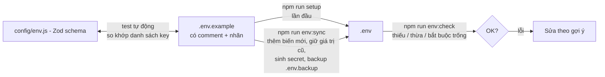
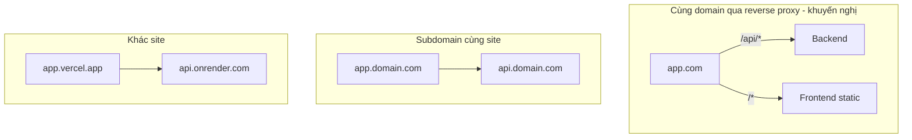

# 06. Biến môi trường (Environment variables)

## Nguyên tắc

1. **`.env.example` là nguồn sự thật** (_source of truth_) — được commit, mô tả đầy đủ từng biến. `.env` thật **không bao giờ commit** (đã chặn trong `.gitignore`).
2. **`.env` luôn đồng bộ với `.env.example`** — cùng danh sách key, cùng thứ tự.
3. **Validate khi khởi động** bằng Zod: backend (`backend/src/config/env.js`), frontend (`frontend/src/core/config/env.js`). Sai ⇒ dừng ngay với thông báo dễ hiểu.
4. **Code không đọc `process.env` / `import.meta.env` trực tiếp** — luôn import `env` từ file config.

### Mức độ quan trọng

| Nhãn               | Ý nghĩa                                                                             |
| ------------------ | ----------------------------------------------------------------------------------- |
| `[REQUIRED]` 🔴    | Bắt buộc — app không chạy đúng nếu thiếu/sai                                        |
| `[SECRET]` 🔴      | Bắt buộc **và bí mật** — không chia sẻ, mỗi môi trường một giá trị, lộ thì đổi ngay |
| `[RECOMMENDED]` 🟡 | Có mặc định nhưng nên chỉnh theo môi trường                                         |
| `[OPTIONAL]` 🟢    | Tuỳ chọn — để trống thì tính năng liên quan tắt / dùng mặc định                     |
| `[auto-generate]`  | `npm run setup` / `npm run env:sync` tự sinh giá trị ngẫu nhiên khi còn trống       |

## Cơ chế đồng bộ

- `npm run dev` luôn chạy `env:check` trước.
- Test `backend/tests/unit/env.test.js` và `frontend/src/core/config/env.test.js` **fail nếu schema và `.env.example` lệch nhau** → không thể quên khai báo biến mới.
- Test `scripts/lib/envFile.test.js` đảm bảo **mọi biến** có đủ 3 mục _Ý nghĩa / Cách tạo / Mức độ_.

**Khi thêm biến mới:** thêm vào Zod schema → thêm block mô tả vào `.env.example` → `npm run env:sync` → cập nhật bảng dưới đây.

## Backend (`backend/.env`)

### App

| Biến             | Mức độ           | Mặc định                | Ý nghĩa & cách tạo                                                           |
| ---------------- | ---------------- | ----------------------- | ---------------------------------------------------------------------------- |
| `NODE_ENV`       | 🟡 RECOMMENDED   | `development`           | `development` / `test` / `production`. Ảnh hưởng log, cookie, auto index     |
| `PORT`           | 🟡 RECOMMENDED   | `8000`                  | Cổng API. Đổi thì sửa `DEV_API_PROXY_TARGET` (FE)                            |
| `APP_NAME`       | 🟡 RECOMMENDED   | `Source Base`           | Tên app trong email/log, là `issuer` của JWT (đổi ⇒ access token cũ vô hiệu) |
| `API_PUBLIC_URL` | 🔴 khi bật OAuth | `http://localhost:8000` | URL công khai của backend, dùng tạo OAuth callback URL                       |
| `FRONTEND_URL`   | 🔴 REQUIRED      | `http://localhost:5173` | Dùng tạo link trong email & redirect sau OAuth                               |
| `CORS_ORIGINS`   | 🔴 REQUIRED      | `http://localhost:5173` | Origin được gọi API, cách nhau bởi dấu phẩy                                  |
| `TRUST_PROXY`    | 🟡 RECOMMENDED   | `0`                     | Số lớp proxy phía trước (Nginx/Cloudflare = 1) để lấy đúng IP client         |
| `LOG_LEVEL`      | 🟢 OPTIONAL      | `info`                  | `fatal` … `trace`, `silent`                                                  |

### Database

| Biến          | Mức độ    | Ý nghĩa & cách tạo                                                                                                                                                                                                                                                                                                  |
| ------------- | --------- | ------------------------------------------------------------------------------------------------------------------------------------------------------------------------------------------------------------------------------------------------------------------------------------------------------------------- |
| `MONGODB_URI` | 🔴 SECRET | Chuỗi kết nối MongoDB. **Local**: `mongodb://127.0.0.1:27017/<tên_db>`. **Atlas**: Cluster → Connect → Drivers → `mongodb+srv://<user>:<pass>@<cluster>.mongodb.net/<tên_db>?retryWrites=true&w=majority` (whitelist IP ở _Network Access_). Nên ghi rõ `<tên_db>` — thiếu thì Mongo dùng database mặc định `test`. |

### Auth / bảo mật

| Biến                        | Mức độ                    | Mặc định | Ý nghĩa & cách tạo                                                                                                      |
| --------------------------- | ------------------------- | -------- | ----------------------------------------------------------------------------------------------------------------------- |
| `JWT_ACCESS_SECRET`         | 🔴 SECRET · auto-generate | —        | Khoá ký access token, ≥ 32 ký tự. Tạo: `node -e "console.log(require('crypto').randomBytes(48).toString('base64url'))"` |
| `JWT_ACCESS_EXPIRES_IN`     | 🟡 RECOMMENDED            | `15m`    | Hạn access token (`<số><ms\|s\|m\|h\|d\|w>`)                                                                            |
| `REFRESH_TOKEN_EXPIRES_IN`  | 🟡 RECOMMENDED            | `7d`     | Hạn phiên (trượt theo mỗi lần refresh)                                                                                  |
| `COOKIE_SECRET`             | 🔴 SECRET · auto-generate | —        | Khoá ký cookie (state OAuth). Khác `JWT_ACCESS_SECRET`                                                                  |
| `COOKIE_SECURE`             | 🔴 REQUIRED               | `false`  | `true` = chỉ gửi qua HTTPS. **Production bắt buộc `true`** (app từ chối khởi động nếu sai)                              |
| `COOKIE_SAME_SITE`          | 🟡 RECOMMENDED            | `lax`    | `lax` khi FE/BE cùng site; `none` khi khác site (bắt buộc `COOKIE_SECURE=true`)                                         |
| `MAGIC_LINK_EXPIRES_IN`     | 🟢 OPTIONAL               | `15m`    | Hạn magic link                                                                                                          |
| `EMAIL_VERIFY_EXPIRES_IN`   | 🟢 OPTIONAL               | `24h`    | Hạn link xác thực email                                                                                                 |
| `PASSWORD_RESET_EXPIRES_IN` | 🟢 OPTIONAL               | `30m`    | Hạn link đặt lại mật khẩu                                                                                               |

### OAuth (để trống = tắt; phải khai báo đủ cặp)

| Biến                   | Mức độ      | Cách tạo                                                                                                                                         |
| ---------------------- | ----------- | ------------------------------------------------------------------------------------------------------------------------------------------------ |
| `GOOGLE_CLIENT_ID`     | 🟢 OPTIONAL | Google Cloud Console → APIs & Services → Credentials → OAuth client ID (Web). Redirect URI: `<API_PUBLIC_URL>/api/v1/auth/oauth/google/callback` |
| `GOOGLE_CLIENT_SECRET` | 🟢 OPTIONAL | Tạo cùng Client ID (bí mật)                                                                                                                      |
| `GITHUB_CLIENT_ID`     | 🟢 OPTIONAL | GitHub → Settings → Developer settings → OAuth Apps. Callback: `<API_PUBLIC_URL>/api/v1/auth/oauth/github/callback`                              |
| `GITHUB_CLIENT_SECRET` | 🟢 OPTIONAL | Generate a new client secret (bí mật)                                                                                                            |

### Mail, rate limit, seed

| Biến                   | Mức độ                    | Mặc định                             | Ý nghĩa                                                                  |
| ---------------------- | ------------------------- | ------------------------------------ | ------------------------------------------------------------------------ |
| `MAIL_DRIVER`          | 🟡 RECOMMENDED            | `console`                            | `console` (in ra log) / `memory` (test). Phase Mail thêm `smtp`/`resend` |
| `MAIL_FROM`            | 🟡 RECOMMENDED            | `Source Base <no-reply@example.com>` | Người gửi                                                                |
| `RATE_LIMIT_WINDOW_MS` | 🟢 OPTIONAL               | `900000`                             | Cửa sổ đếm request (ms)                                                  |
| `RATE_LIMIT_MAX`       | 🟢 OPTIONAL               | `300`                                | Request tối đa / IP / cửa sổ (toàn API)                                  |
| `AUTH_RATE_LIMIT_MAX`  | 🟡 RECOMMENDED            | `20`                                 | Request tối đa cho endpoint auth (chống brute-force, spam mail)          |
| `SUPER_ADMIN_NAME`     | 🟢 OPTIONAL               | `Super Admin`                        | Chỉ dùng cho `npm run seed`                                              |
| `SUPER_ADMIN_EMAIL`    | 🔴 khi chạy seed          | `superadmin@example.com`             | Email superAdmin                                                         |
| `SUPER_ADMIN_PASSWORD` | 🔴 SECRET · auto-generate | —                                    | Mật khẩu ban đầu (≥ 8 ký tự, có chữ + số). Đổi sau lần đăng nhập đầu     |

## Frontend (`frontend/.env`)

> ⚠️ Biến `VITE_*` được **nhúng vào bundle JS** — ai cũng đọc được. Không bao giờ đặt secret.

| Biến                         | Mức độ         | Mặc định                | Ý nghĩa & cách tạo                                                  |
| ---------------------------- | -------------- | ----------------------- | ------------------------------------------------------------------- |
| `VITE_APP_NAME`              | 🟡 RECOMMENDED | `Source Base`           | Tên hiển thị (header, title)                                        |
| `VITE_API_URL`               | 🔴 REQUIRED    | `/api/v1`               | Dev: `/api/v1` (qua proxy Vite). Production khác domain: URL đầy đủ |
| `VITE_API_TIMEOUT`           | 🟢 OPTIONAL    | `15000`                 | Timeout request (ms)                                                |
| `VITE_ENABLE_QUERY_DEVTOOLS` | 🟢 OPTIONAL    | `true` (dev)            | Bật TanStack Query Devtools                                         |
| `DEV_PORT`                   | 🟢 OPTIONAL    | `5173`                  | Cổng Vite dev/preview (chỉ dùng trong `vite.config.js`)             |
| `DEV_API_PROXY_TARGET`       | 🟡 RECOMMENDED | `http://localhost:8000` | Backend mà proxy `/api` trỏ tới khi dev                             |

## Cấu hình theo môi trường triển khai

| Kịch bản    | `VITE_API_URL`                    | `COOKIE_SAME_SITE` | `COOKIE_SECURE` | `CORS_ORIGINS`           |
| ----------- | --------------------------------- | ------------------ | --------------- | ------------------------ |
| Cùng domain | `/api/v1`                         | `lax`              | `true`          | `https://app.com`        |
| Subdomain   | `https://api.domain.com/api/v1`   | `lax`              | `true`          | `https://app.domain.com` |
| Khác site   | `https://api.onrender.com/api/v1` | `none`             | `true`          | `https://app.vercel.app` |

Production nhớ: `NODE_ENV=production`, `TRUST_PROXY=1` (nếu sau proxy), secret mới hoàn toàn, `LOG_LEVEL=info`.
