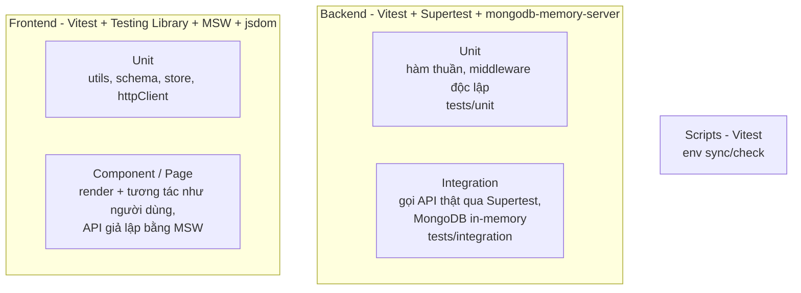

# 07. Testing

## Chiến lược



| Phần     | Công cụ                                                                                                                           | Vị trí test                                       | Lệnh                   |
| -------- | --------------------------------------------------------------------------------------------------------------------------------- | ------------------------------------------------- | ---------------------- |
| Backend  | Vitest, **Supertest** (_gọi HTTP vào app không cần listen_), **mongodb-memory-server** (_MongoDB thật chạy trong RAM_)            | `backend/tests/**`                                | `npm run test:be`      |
| Frontend | Vitest, **Testing Library** (_test theo hành vi người dùng_), **MSW** (_Mock Service Worker — giả lập API ở tầng network_), jsdom | `frontend/src/**/*.test.{js,jsx}` (đặt cạnh code) | `npm run test:fe`      |
| Scripts  | Vitest                                                                                                                            | `scripts/**/*.test.js`                            | `npm run test:scripts` |

`npm test` chạy cả 3; `npm run test:coverage` kèm báo cáo độ phủ (backend có ngưỡng tối thiểu: lines/functions/statements 85%, branches 75%).

## Backend

### Hạ tầng

- `tests/setup/globalSetup.js`: khởi động **1** MongoMemoryServer cho cả lượt test, chia sẻ URI qua `project.provide`.
- `tests/setup/database.js`: mỗi file test dùng **database riêng** (chạy song song không đụng nhau), xoá dữ liệu sau mỗi test, xoá outbox mail.
- Env test cố định trong `vitest.config.js` (`MAIL_DRIVER=memory`, `LOG_LEVEL=silent`, rate limit rất cao, OAuth credentials giả) — **không đọc `backend/.env`**.
- Lần đầu chạy sẽ tải binary MongoDB (~800MB) vào cache, các lần sau nhanh.

### Helper (`tests/helpers.js`)

```js
const { user, accessToken, refreshCookie } = await loginAs('admin'); // tạo user + đăng nhập qua API
const member = await createUser({ role: 'member', isActive: false });
await request(app).get(api('/users')).set(bearer(accessToken)).expect(200);
const token = getTokenFromLastMail('a@example.com'); // lấy token trong email (driver memory)
getCookie(res, 'refresh_token'); // "refresh_token=..."
```

### Mock OAuth provider

```js
vi.spyOn(globalThis, 'fetch').mockImplementation(async (url) =>
  String(url).includes('/token') ? jsonResponse({ access_token: 't' }) : jsonResponse(profile),
);
```

(Supertest không dùng `fetch` nên mock `fetch` chỉ ảnh hưởng lời gọi tới provider.)

## Frontend

### Hạ tầng

- `src/test/setup.js`: bật MSW (`onUnhandledRequest: 'error'` — request chưa mock sẽ làm test fail), dọn DOM/token/toast sau mỗi test.
- `src/test/msw/handlers.js`: handler mặc định = backend ở trạng thái **chưa đăng nhập** (`/auth/refresh` → 401) + vài sản phẩm mẫu. Ghi đè trong từng test bằng `server.use(...)`.
- `src/test/render.jsx`:
  - `renderWithProviders(<Page/>, { route, path, session })` — render 1 trang trong memory router; route `*` hiển thị URL (`data-testid="location"`) để kiểm tra điều hướng.
  - `renderRoutes({ routes, initialEntries, session })` — render cả cây route (kể cả `routes.jsx` thật).
  - `renderHookWithProviders(() => useX(), { session, route })`.
  - `session`: `undefined` = app tự gọi refresh, `null` = khách, `buildUser({ role })` = đã đăng nhập.
- `src/test/fixtures.js`: `buildUser`, `buildProduct`, `pageMeta`.

### Ví dụ

```jsx
it('admin tạo sản phẩm qua modal', async () => {
  server.use(http.post(apiUrl('/products'), async ({ request }) => ok(await request.json())));
  const { user } = renderWithProviders(<ProductManagementPage />, {
    session: buildUser({ role: 'admin' }),
  });

  await user.click(await screen.findByRole('button', { name: '+ Thêm sản phẩm' }));
  const dialog = screen.getByRole('dialog', { name: 'Thêm sản phẩm' });
  await user.type(within(dialog).getByLabelText(/Tên sản phẩm/), 'Màn hình');
  await user.type(within(dialog).getByLabelText(/Giá/), '5990000');
  await user.click(within(dialog).getByRole('button', { name: 'Tạo sản phẩm' }));

  expect(await screen.findByText('Đã tạo sản phẩm')).toBeInTheDocument();
});
```

**Nguyên tắc Testing Library:** truy vấn như người dùng nhìn thấy (`getByRole`, `getByLabelText`, `getByText`), không truy vấn class CSS / cấu trúc DOM nội bộ.

## Những gì đang được test

| Nhóm              | Nội dung chính                                                                                                                                                   |
| ----------------- | ---------------------------------------------------------------------------------------------------------------------------------------------------------------- |
| Env               | Schema ↔ `.env.example` đồng bộ; mặc định; chặn cấu hình cookie nguy hiểm; mọi biến có đủ mô tả                                                                  |
| Core BE           | AppError, normalizeError (Zod/Mongoose/Mongo/JWT/body-parser), asyncHandler, validate, rate limit, utils, RBAC policy, scrypt, JWT (alg none, hết hạn, sai loại) |
| Auth - password   | Đăng ký, đăng nhập (lỗi đồng nhất), `/me`, khoá/xoá user có hiệu lực ngay, verify email, resend, forgot/reset, đổi mật khẩu                                      |
| Auth - session    | Rotation, grace period nhiều tab, reuse detection, hết hạn, logout, logout-all, danh sách/thu hồi thiết bị                                                       |
| Auth - magic link | Tạo tài khoản khi mở link, 1 lần dùng, link cũ vô hiệu, chống open redirect, tài khoản bị khoá                                                                   |
| Auth - OAuth      | PKCE/state, tạo mới, không trùng, liên kết theo email đã xác thực, state sai/giả mạo, từ chối quyền, GitHub                                                      |
| Users / Products  | RBAC theo cấp bậc, không tạo superAdmin qua API, `.strict()`, phân trang/tìm kiếm/lọc/sắp xếp, 404/422                                                           |
| Frontend core     | httpClient (Bearer, refresh single-flight, UNAUTHORIZED, skipAuthRefresh, lỗi mạng), ApiError, hooks, toast, rbac                                                |
| Frontend features | Form login/register (validate + lỗi server vào field), guards, trang auth (magic link, OAuth callback, reset...), products CRUD, users RBAC UI, account, routes  |

## Viết test cho tính năng mới

- **Backend**: copy `tests/integration/products.test.js` → sửa endpoint. Tối thiểu: happy path, 401, 403 theo role, 422 validate, 404.
- **Frontend**: test hook dữ liệu (query params gửi đúng, invalidate sau mutation) + test trang (render, thao tác chính, lỗi server).
- Bug fix ⇒ viết test tái hiện bug **trước**, sửa, test pass.
