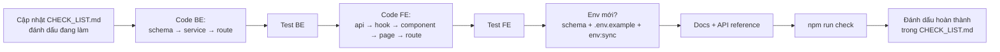

# 08. Quy ước & quy trình

## Coding convention

| Chủ đề        | Quy ước                                                                                             |
| ------------- | --------------------------------------------------------------------------------------------------- |
| Module system | **ESM** (`import/export`) ở mọi nơi. Backend import kèm đuôi `.js`                                  |
| Import alias  | BE: `#config/*`, `#core/*`, `#modules/*`, `#tests/*` · FE: `@/…`                                    |
| Tên file BE   | `<module>.<layer>.js`: `product.service.js`, `auth.routes.js`                                       |
| Tên file FE   | Component/Page: `PascalCase.jsx` · hook: `useXxx.js` · còn lại `camelCase.js`                       |
| Export        | Named export; **page dùng default export** (phục vụ lazy route)                                     |
| Ngôn ngữ      | Code/tên biến tiếng Anh · comment, message cho người dùng, docs: **tiếng Việt**                     |
| Mã lỗi        | `UPPER_SNAKE_CASE` trong `ErrorCodes`; frontend xử lý theo `code`, không theo message               |
| Permission    | `<resource>:<action>` (vd `order:create`)                                                           |
| Env           | Chỉ đọc qua `env` từ `config/env.js` (BE) / `core/config/env.js` (FE)                               |
| Log           | Backend dùng `logger` (pino); không `console.*` trong `src/` (ESLint chặn)                          |
| Style         | Prettier: 2 space, single quote, dấu `;`, trailing comma, 100 ký tự/dòng, tự sắp xếp class Tailwind |

### Nguyên tắc thiết kế

- `core` không import từ `modules`/`features`.
- Feature khác chỉ import qua `features/<x>/index.js` (public API).
- Controller mỏng, logic ở service; service không biết `req/res`.
- Page mỏng, logic ở custom hook.
- Validate **cả hai đầu** (FE cho UX, BE cho bảo mật); quy tắc chung giữ khớp nhau.
- Không hard-code: URL (`PATHS`), query key (`xxxKeys`), permission (`PERMISSIONS`).

## Lint & format

```bash
npm run lint         # ESLint toàn repo (flat config: eslint.config.js)
npm run lint:fix
npm run format       # Prettier
npm run format:check
npm run check        # env:check + lint + format:check + test (như CI)
```

ESLint gồm: `@eslint/js` recommended, `react-hooks` (kể cả rule React Compiler), `react-refresh`, `@vitest/eslint-plugin` cho file test, `eslint-config-prettier` (tắt rule xung đột với Prettier).

VS Code: cài extension gợi ý trong `.vscode/extensions.json`, copy `.vscode/settings.example.json` → `.vscode/settings.json` để format + fix khi lưu.

## Git

- Nhánh: `main` (ổn định) · `feat/<tên>` · `fix/<tên>` · `chore/<tên>` · `docs/<tên>`.
- Commit theo **Conventional Commits** (_quy ước tiền tố commit_):

  ```
  feat(auth): thêm đăng nhập bằng magic link
  fix(products): sửa lỗi giá rỗng thành 0
  docs: cập nhật hướng dẫn env
  test(users): thêm test phân quyền đổi role
  refactor(core): tách buttonVariants
  chore: nâng cấp dependencies
  ```

- Trước khi push: `npm run check` phải xanh.

## Checklist khi thêm / sửa tính năng



- [ ] Có permission mới? → `backend/src/config/permissions.js` + `frontend/src/core/constants/rbac.js`
- [ ] Có biến môi trường mới? → Zod schema + `.env.example` (đủ _Ý nghĩa / Cách tạo / Mức độ_) + `npm run env:sync` + `docs/06-environment.md`
- [ ] Có endpoint mới? → `docs/09-api-reference.md`
- [ ] Test backend (happy path, 401, 403, 422, 404) + frontend (hook + page)
- [ ] `npm run check` xanh
- [ ] Cập nhật `CHECK_LIST.md`
