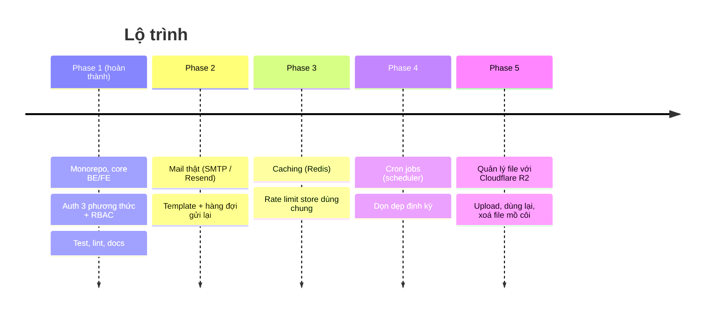
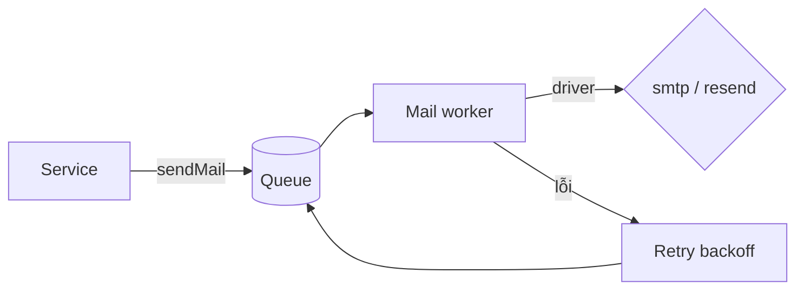
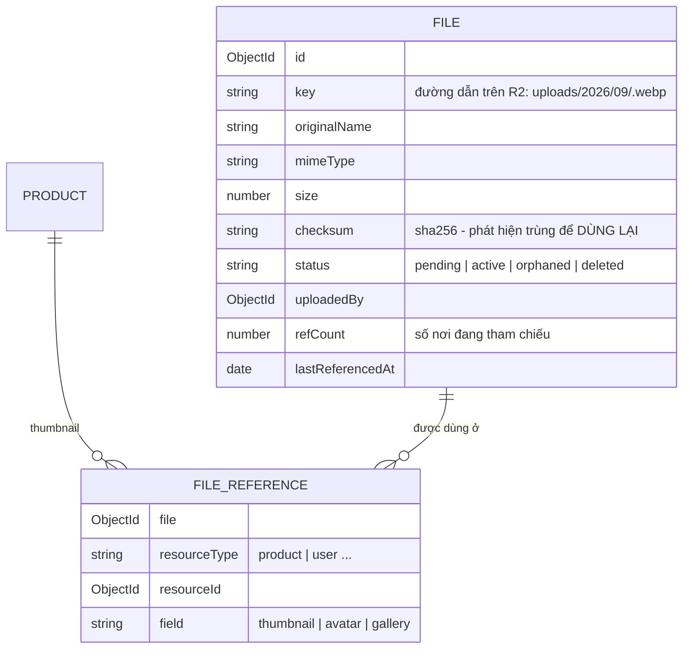
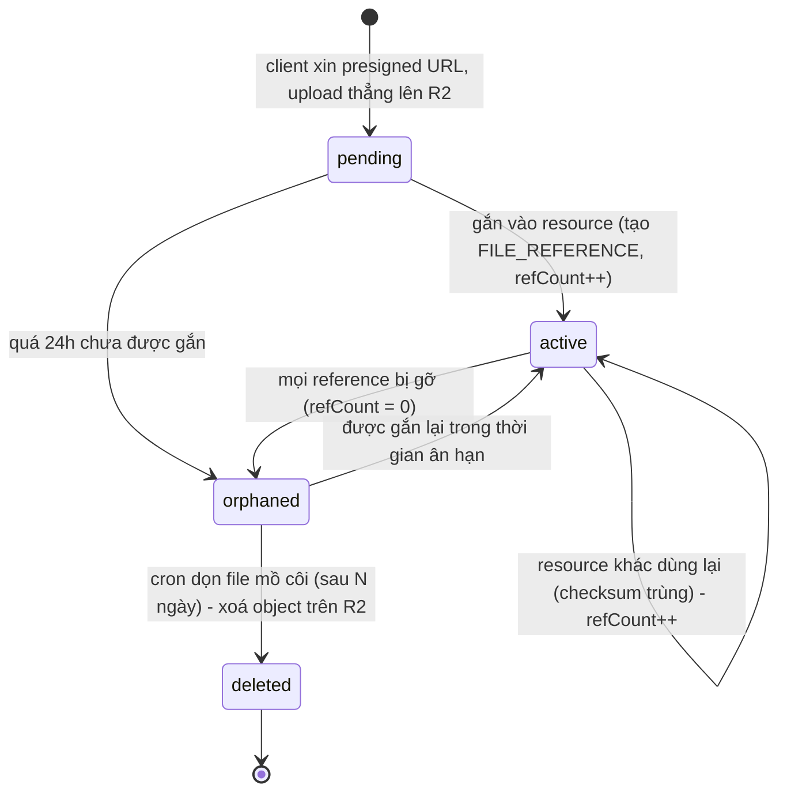
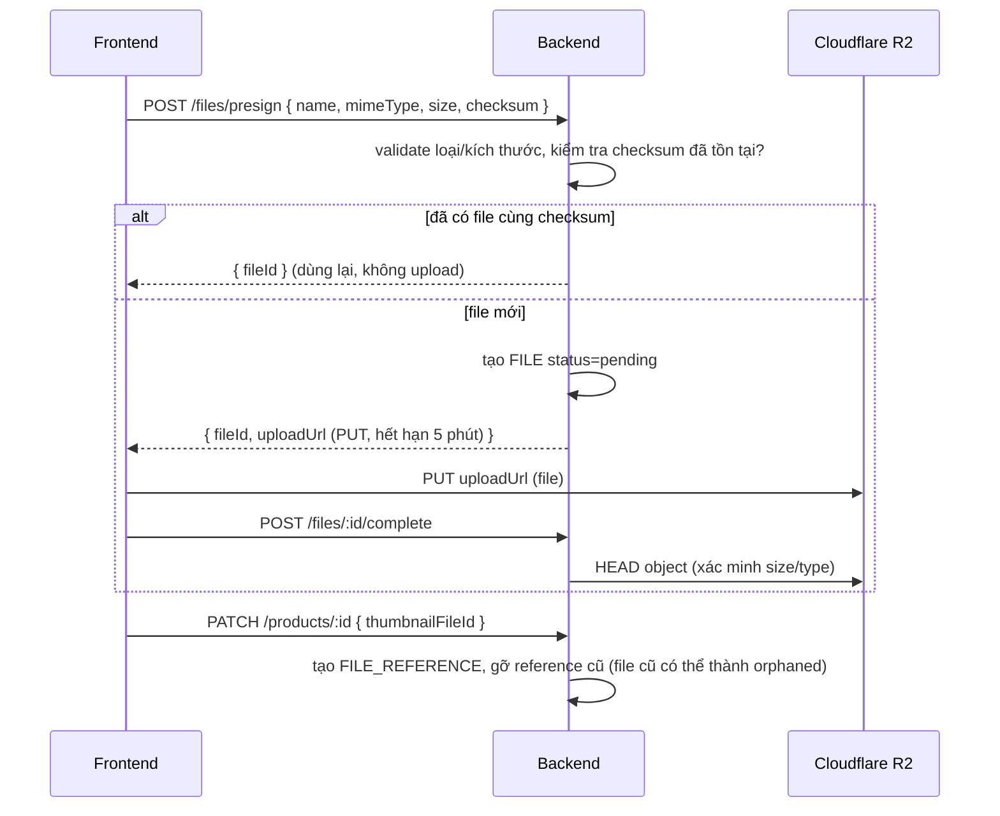

# 10. Roadmap — các phase tiếp theo

Source base hiện tại (**Phase 1**) đã chừa sẵn "điểm cắm" cho các phase sau. Tài liệu này mô tả **thiết kế dự kiến** để triển khai nhất quán. Tiến độ theo dõi ở [`CHECK_LIST.md`](../CHECK_LIST.md).

> Thứ tự đề xuất: **Mail → Cache → Cron → File**, vì Cron cần cho dọn file mồ côi và Cache/Redis có thể làm nền cho hàng đợi.

## Phase 2 — Mail

**Hiện tại:** `core/mail/mailer.js` với driver `console` (dev) và `memory` (test).

**Kế hoạch:**

- Thêm driver `smtp` (nodemailer) và/hoặc `resend` (HTTP API) — chọn bằng `MAIL_DRIVER`.
- Env mới: `SMTP_HOST`, `SMTP_PORT`, `SMTP_USER`, `SMTP_PASSWORD`, `SMTP_SECURE` hoặc `RESEND_API_KEY`.
- Template: tách nội dung email khỏi code (vd thư mục `core/mail/templates/*.js` hoặc React Email), hỗ trợ i18n.
- Gửi bất đồng bộ + thử lại (retry với backoff) — dùng hàng đợi (Phase 3/4: BullMQ trên Redis) để request API không chờ SMTP.
- Endpoint liên hệ (`POST /contact`) cho trang Contact (hiện đang demo).

## Phase 3 — Caching

- Thêm `core/cache/` với interface thống nhất: `get`, `set(key, value, ttl)`, `del`, `wrap(key, ttl, fn)` (cache-aside), driver `memory` (dev/test) và `redis` (production). Env: `CACHE_DRIVER`, `REDIS_URL`.
- Điểm áp dụng đầu tiên:
  - `authenticate` đọc user theo id → cache vài giây, **xoá cache khi đổi role/khoá/xoá user**.
  - Danh sách public (`GET /products`) → cache ngắn + invalidate khi tạo/sửa/xoá.
- Chuyển store của `express-rate-limit` sang Redis để nhiều instance dùng chung.
- Frontend đã có cache phía client (TanStack Query) — giữ nguyên.

## Phase 4 — Cron jobs

- Thêm `core/jobs/` : đăng ký job theo module (`defineJob({ name, schedule, handler })`), chạy bằng `node-cron` (1 instance) hoặc BullMQ repeatable jobs (nhiều instance, có lock chống chạy trùng).
- Env: `CRON_ENABLED`, `CRON_TIMEZONE`.
- Job dự kiến:
  - Dọn `Session` / `AuthToken` (dự phòng cho TTL index).
  - Dọn **file mồ côi** R2 (Phase 5).
  - Gửi lại email thất bại.
- Mỗi job: log thời gian chạy, kết quả; có lệnh chạy tay `npm run job -- <name>` để debug.

## Phase 5 — Quản lý file với Cloudflare R2

**R2** là object storage tương thích **S3 API** (dùng `@aws-sdk/client-s3`), không tính phí egress.

### Thiết kế dữ liệu

### Vòng đời file

### Luồng upload (presigned URL)

### Kế hoạch triển khai

- `core/storage/` : interface `putPresignedUrl`, `head`, `delete`, `getPublicUrl` — driver `r2` và `local` (dev/test).
- Module `file`: model `File`, `FileReference`, service `attach/detach/replace` dùng **transaction** MongoDB để refCount luôn đúng.
- Env: `R2_ACCOUNT_ID`, `R2_ACCESS_KEY_ID`, `R2_SECRET_ACCESS_KEY`, `R2_BUCKET`, `R2_PUBLIC_URL`, `UPLOAD_MAX_SIZE_MB`, `UPLOAD_ALLOWED_TYPES`, `ORPHAN_FILE_RETENTION_DAYS`.
- Frontend: component `FileUpload` + hook `useFileUpload` (progress, retry, tính checksum bằng Web Crypto), thay ô "Ảnh (URL)" ở `ProductForm` và avatar ở hồ sơ.
- Bảo mật: whitelist MIME + kiểm tra magic bytes, giới hạn kích thước, key ngẫu nhiên (không dùng tên gốc), bucket private + URL ký cho file riêng tư.

## Ngoài lộ trình chính (ý tưởng)

- CI (GitHub Actions): `npm ci && npm run check` trên mỗi PR; husky + lint-staged.
- E2E test bằng Playwright.
- Docker Compose (MongoDB + Redis + app) cho môi trường dev đồng nhất.
- OpenAPI/Swagger sinh từ Zod schema.
- i18n cho frontend và message lỗi backend.
- 2FA (TOTP) cho admin/superAdmin, audit log thao tác quản trị.
